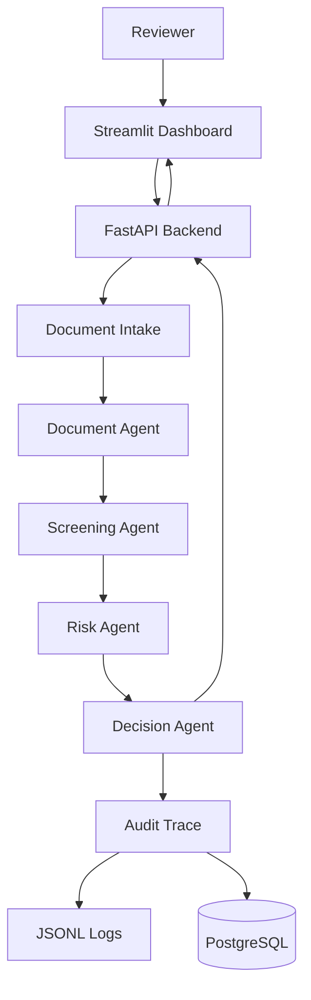
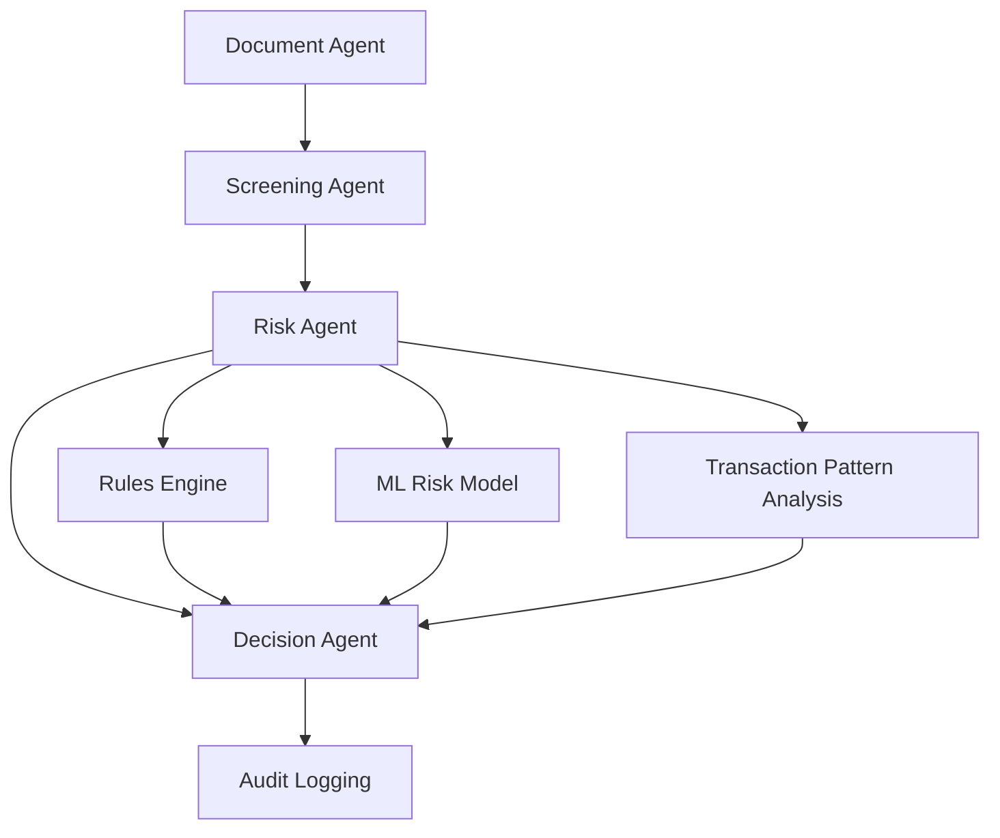

# 🛡️ ComplyAgent

### AI-Powered KYC & AML Compliance Intelligence

A multi-agent compliance review system that combines document intelligence, sanctions screening, machine-learning risk scoring, and fully traceable decisions.


> **Project status:** Educational and portfolio project built on synthetic data. It is not intended for real-world financial compliance decisions.

---

## 📑 Table of Contents

- [Overview](#-overview)
- [Key Features](#-key-features)
- [Live Deployment](#-live-deployment)
- [Architecture](#-architecture)
- [Workflow](#-workflow)
- [Technology Stack](#-technology-stack)
- [Dataset](#-dataset)
- [Project Structure](#-project-structure)
- [Installation and Setup](#-installation-and-setup)
- [Docker](#-docker)
- [Model Evaluation](#-model-evaluation)
- [Testing](#-testing)
- [Data Privacy and Responsible Use](#-data-privacy-and-responsible-use)
- [Limitations](#-limitations)
- [Future Improvements](#-future-improvements)
- [Author](#-author)

---

## 🔎 Overview

ComplyAgent demonstrates how computer vision, machine learning, workflow orchestration, API development, and audit logging can work together in a single compliance workflow.

A reviewer selects a case, uploads an identity document, and ComplyAgent runs the compliance analysis pipeline. The output is a decision of **APPROVE**, **REVIEW**, or **REJECT**, supported by evidence such as OCR results, tamper indicators, sanctions screening, risk scores, triggered rules, and an audit trace.

The system is designed to support human review, not replace compliance professionals.

---

## 🚀 Key Features

| Capability                | Description                                                                           |
| ------------------------- | ------------------------------------------------------------------------------------- |
| **Document Verification** | Processes uploaded identity documents in supported image formats.                     |
| **OCR Extraction**        | Extracts text and confidence scores using Tesseract OCR.                              |
| **Tamper Detection**      | Uses Error Level Analysis (ELA) to flag potential image manipulation.                 |
| **Sanctions Screening**   | Screens identities against configured sanctions data and evaluates potential matches. |
| **Risk Assessment**       | Combines machine-learning risk scoring with a deterministic rules engine.             |
| **Transaction Analysis**  | Evaluates suspicious transaction patterns and risk indicators.                        |
| **Multi-Agent Workflow**  | Coordinates document, screening, risk, and decision agents using LangGraph.           |
| **REST API**              | Exposes compliance functionality through FastAPI.                                     |
| **Reviewer Dashboard**    | Provides a Streamlit interface for reviewing cases and results.                       |
| **Audit Logging**         | Records decision evidence and trace information for auditability.                     |

---

## 🌐 Live Deployment

ComplyAgent is deployed on **Render** using separate services for the FastAPI backend and Streamlit reviewer dashboard.

| Component                         | Link                                                                     |
| --------------------------------- | ------------------------------------------------------------------------ |
| **Live Reviewer Dashboard**       | [Open ComplyAgent Dashboard](https://complyagent-dashboard.onrender.com) |
| **API Base URL**                  | [ComplyAgent API](https://complyagent-w8hs.onrender.com)                 |
| **Interactive API Documentation** | [Swagger UI](https://complyagent-w8hs.onrender.com/docs)                 |
| **API Health Check**              | [Check API Health](https://complyagent-w8hs.onrender.com/health)         |

### Deployment Details

- **Hosting platform:** Render
- **Backend:** FastAPI REST API
- **Containerization:** Docker
- **Frontend:** Streamlit reviewer dashboard
- **API documentation:** FastAPI Swagger UI
- **Health endpoint:** `/health`

The dashboard provides the user interface, while the API processes requests and returns compliance analysis results.

> **Note:** Free hosting services may take time to start after inactivity. The first request can take up to a minute while the services wake up. The deployed application is an educational prototype using synthetic data.

---

## 🏗️ Architecture



### Agent Architecture



The workflow separates document analysis, identity screening, risk assessment, decision support, and audit logging into distinct components.

---

## 🔄 Workflow

### Step 1: Case Selection and Document Upload

The reviewer selects a customer case and submits an identity document through the Streamlit dashboard.

### Step 2: Document Intake

The uploaded image is processed using OpenCV and Tesseract OCR. The system extracts text, calculates OCR confidence, and evaluates the image using Error Level Analysis.

### Step 3: Document Agent

The Document Agent structures the extracted information into validated evidence, including OCR results, document-quality classification, and potential tampering indicators.

### Step 4: Screening Agent

The Screening Agent evaluates the supplied identity information against the configured sanctions data and records screening evidence.

### Step 5: Risk Agent

The Risk Agent combines multiple risk signals:

- Machine-learning risk prediction
- Deterministic rule evaluation
- Transaction-pattern indicators
- Sanctions-related risk information

These signals contribute to an overall risk score and risk classification.

### Step 6: Decision Agent

The Decision Agent evaluates screening and risk evidence and produces one of three outcomes:

- **APPROVE** — the configured rules permit approval.
- **REVIEW** — further human assessment is required.
- **REJECT** — the configured rules indicate rejection.

These are prototype decision outcomes, not authoritative compliance determinations.

### Step 7: Audit Trace

The system assembles the available evidence, records the decision, and persists the audit trace through the configured logging system.

### Step 8: Result Display

The API returns the analysis results, and the reviewer dashboard presents the available decision, risk information, and supporting evidence.

---

## 🛠️ Technology Stack

| Technology        | Purpose                                                    |
| ----------------- | ---------------------------------------------------------- |
| **Python 3.11**   | Core programming language                                  |
| **FastAPI**       | REST API and backend services                              |
| **Streamlit**     | Interactive reviewer dashboard                             |
| **LangGraph**     | Multi-agent workflow orchestration                         |
| **Pydantic**      | Data validation and structured agent contracts             |
| **Scikit-learn**  | Machine-learning risk scoring                              |
| **OpenCV**        | Image processing and ELA preparation                       |
| **Pillow**        | Image handling                                             |
| **Tesseract OCR** | Text extraction from identity documents                    |
| **Pandas**        | Data loading, transformation, and analysis                 |
| **NumPy**         | Numerical computation                                      |
| **PostgreSQL**    | Relational database and audit storage integration          |
| **JSONL**         | Structured audit-trace logging                             |
| **MCP**           | Model Context Protocol server exposing tools (`mcp_server/`) |
| **Docker**        | Containerization and deployment                            |
| **Pytest**        | Automated testing                                          |
| **Render**        | Cloud hosting for the API and dashboard                    |
| **Git & GitHub**  | Version control and source-code hosting                    |

<!-- TODO: after checking mcp_server/, add one line here listing the actual MCP tool names and what each does. -->

---

## 📦 Dataset

| Detail                              | Value                                                           |
| ----------------------------------- | --------------------------------------------------------------- |
| Document source                     | MIDV-500 benchmark (13.45 GB download, excluded from this repo) |
| Valid document image–metadata pairs | 4,200                                                           |
| Document types                      | 14 (300 images each)                                            |
| Synthetic identity records          | 100 (generated separately from MIDV-500)                        |

The 100 synthetic identities are linked to benchmark documents only as a testing arrangement. They do not represent real people.

---

## 📁 Project Structure

```
ComplyAgent/
├── agents/                 # Document, screening, risk, and decision agents
├── api/                    # FastAPI application and endpoints
├── audit/                  # Audit-trace creation and persistence
├── console/                # Streamlit reviewer dashboard
├── data_generation/        # Synthetic data and document utilities
├── docker/                 # Additional Docker-related resources
├── docs/                   # Project documentation
├── evaluation/             # Model evaluation scripts
├── mcp_server/             # MCP server and tools
├── orchestration/          # LangGraph workflow
├── risk_model/             # Risk scoring and rules engine
├── tests/                  # Automated tests
├── vision/                 # OCR and tampering analysis
├── Dockerfile              # API container configuration
├── .dockerignore           # Docker build exclusions
├── .gitignore              # Git exclusions
├── requirements.txt        # Python dependencies
└── README.md               # Project documentation
```

---

## 💻 Installation and Setup

### Prerequisites

- Python 3.11
- Git
- [Tesseract OCR](https://github.com/tesseract-ocr/tesseract)
- Docker Desktop (optional)

### 1. Clone the Repository

```bash
git clone https://github.com/vaishnavi-c12488/ComplyAgent.git
cd ComplyAgent
```

### 2. Create a Virtual Environment

**Windows (PowerShell):**

```powershell
python -m venv .venv
.\.venv\Scripts\Activate.ps1
```

**macOS / Linux:**

```bash
python3.11 -m venv .venv
source .venv/bin/activate
```

### 3. Install Dependencies

```bash
python -m pip install -r requirements.txt
```

### 4. Configure Tesseract OCR

Install Tesseract and ensure its executable is available through your system `PATH`. If required, configure the `TESSERACT_CMD` environment variable to point to the executable.

### 5. Start the FastAPI Backend

```bash
python -m uvicorn api.main:app --host 127.0.0.1 --port 8000
```

Open the following local endpoints:

| Resource                      | URL                            |
| ----------------------------- | ------------------------------ |
| API root                      | <http://127.0.0.1:8000/>       |
| Interactive API documentation | <http://127.0.0.1:8000/docs>   |
| Health check                  | <http://127.0.0.1:8000/health> |

### 6. Start the Streamlit Dashboard

Open a second terminal, activate the virtual environment, and run:

```bash
python -m streamlit run console/streamlit_reviewer.py
```

Open the local dashboard URL printed in the terminal.

> **Note:** Local execution requires the expected project data files. Database-backed functionality also requires the appropriate PostgreSQL configuration and connection.

---

## 🐳 Docker

Build the API image:

```bash
docker build -t complyagent .
```

Run the API container:

```bash
docker run --rm -p 8000:8000 complyagent
```

Open the API documentation at <http://localhost:8000/docs>.

The current Dockerfile starts the FastAPI service. The Streamlit dashboard is deployed separately, and database-backed functionality requires its own configuration.

---

## 📊 Model Evaluation

The current recorded evaluation on synthetic data reports the following metrics:

| Metric    | Result |
| --------- | ------ |
| Accuracy  | 93.60% |
| Precision | 91.35% |
| Recall    | 85.56% |
| F1-score  | 88.36% |

Recall is lower than precision, which means the model misses some risky cases. In a compliance setting, missed cases cost more than false alarms, so a production system would tune the decision threshold toward higher recall.

These results describe the recorded synthetic-data evaluation only. They do not establish performance on real customer documents, financial transactions, or operational compliance cases.

---

## 🧪 Testing

Run the automated tests from the project root:

```bash
python -m pytest tests/ -v
```

The latest recorded test run completed with **8 passing tests**. Results may differ as the project and test suite evolve.

---

## 🔐 Data Privacy and Responsible Use

- ComplyAgent is an educational and portfolio project.
- Synthetic customer identities are generated for testing.
- Document images are sourced from the MIDV-500 benchmark.
- Linking a synthetic identity to a benchmark document is a testing arrangement and does not establish that the document belongs to that identity.
- The large MIDV-500 source dataset is excluded from the Git repository.
- Never commit API keys, credentials, real identity documents, or sensitive customer records.

---

## ⚠️ Limitations

- ELA identifies potential image-manipulation indicators; it does not prove forgery.
- Tamper-detection performance has not been benchmarked on labeled forged documents.
- OCR may extract incorrect or incomplete text.
- Machine-learning predictions and rules may produce incorrect risk classifications.
- Sanctions screening can generate false positives or miss relevant matches.
- Evaluation metrics are based on synthetic data and should not be generalized to real-world performance.
- Production use would require extensive validation, security hardening, data governance, human oversight, and regulatory review.

---

## 🔮 Future Improvements

- Add a baseline comparison (rules only vs rules + ML) and a confusion matrix.
- Evaluate ELA tamper detection on a labeled set of altered documents.
- Improve deployment reliability and production readiness.
- Configure managed PostgreSQL for persistent audit records.
- Improve low-confidence OCR handling and document-quality assessment.
- Expand automated tests, including per-agent tests and CI.
- Add monitoring, structured error reporting, and secure configuration management.
- Evaluate on appropriately authorized, representative datasets.

---

## 👩‍💻 Author

Developed as a Data Science and AI portfolio project exploring compliance automation, machine learning, computer vision, workflow orchestration, and cloud deployment.

**Vaishnavi Chavan**

[GitHub](https://github.com/vaishnavi-c12488) · [LinkedIn](https://www.linkedin.com/in/vaishnavi-chavan-99718b31a)
