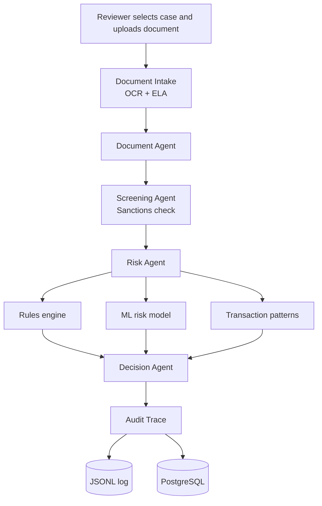

<div align="center">

# 🛡️ ComplyAgent

### AI-Powered KYC & AML Compliance Intelligence

A multi-agent compliance review system that combines document intelligence, sanctions screening, machine-learning risk scoring, and fully traceable decisions.


</div>

> **Project status:** Educational and portfolio project built on **synthetic data**. It is **not** intended for real-world financial compliance decisions.

---

## 📑 Table of Contents

- [Overview](#-overview)
- [Key Features](#-key-features)
- [Architecture](#-architecture)
- [Technology Stack](#-technology-stack)
- [Project Structure](#-project-structure)
- [Installation and Setup](#-installation-and-setup)
- [Docker](#-docker)
- [Model Evaluation](#-model-evaluation)
- [Testing](#-testing)
- [Data Privacy and Responsible Use](#-data-privacy-and-responsible-use)
- [Limitations](#-limitations)
- [Future Improvements](#-future-improvements)
- [Author](#-author)

---

## 🔎 Overview

ComplyAgent demonstrates how computer vision, machine learning, workflow orchestration, API development, and audit logging can work together in a single, explainable compliance workflow.

A reviewer selects a case, uploads an identity document, and ComplyAgent runs the complete pipeline. The output is a decision of **APPROVE**, **REVIEW**, or **REJECT**, supported by the evidence behind it: OCR results, tamper indicators, sanctions screening, risk scores, triggered rules, and a complete audit trace.

The system is designed to **support human review, not replace compliance professionals.**

<!--
Add screenshots after saving them in docs/screenshots/, then uncomment:


-->

---

## 🚀 Key Features

| Capability | Description |
|---|---|
| **Document Verification** | Processes uploaded identity documents (JPG, JPEG, PNG, TIF, TIFF). |
| **OCR Extraction** | Extracts text and confidence scores using Tesseract OCR. |
| **Tamper Detection** | Applies Error Level Analysis (ELA) to flag potential image manipulation. |
| **Sanctions Screening** | Screens identities against sanctions data sources and reports match score and reason. |
| **Risk Assessment** | Combines a machine-learning risk scorer with a deterministic rules engine. |
| **Transaction Analysis** | Detects suspicious patterns such as structuring, rapid movement, and high-risk jurisdictions. |
| **Workflow Orchestration** | Coordinates all agents with LangGraph. |
| **REST API** | Exposes the workflow through FastAPI endpoints. |
| **Reviewer Dashboard** | Interactive Streamlit console with a verdict, evidence workbench, and audit view. |
| **Audit Logging** | Persists a complete evidence trace to JSONL and PostgreSQL. |

---

## 🏗️ Architecture



### Workflow

1. **Document submission:** The reviewer uploads an identity document for the selected case.
2. **OCR extraction:** Text and confidence are extracted from the document.
3. **Document analysis:** ELA identifies potential tampering indicators.
4. **Screening:** The identity is checked against sanctions data.
5. **Risk assessment:** Rules, ML scoring, and transaction patterns are combined into an overall risk score and level.
6. **Decision support:** The Decision Agent produces an outcome with reasoning and supporting evidence.
7. **Auditability:** The full evidence trace is recorded for traceability.

---

## 🛠️ Technology Stack

| Technology | Purpose |
|---|---|
| Python 3.11 | Core programming language |
| FastAPI | REST API development |
| Streamlit | Reviewer interface |
| LangGraph | Workflow orchestration |
| Scikit-learn | Machine learning and risk scoring |
| OpenCV | Image processing |
| Pillow | Image handling |
| Tesseract OCR | Document text extraction |
| Pandas & NumPy | Data processing |
| PostgreSQL | Database connectivity and audit storage |
| MCP | Tool integration |
| Docker | Containerization |
| Pytest | Automated testing |

---

## 📁 Project Structure

```text
ComplyAgent/
├── agents/                 # Document, screening, risk, and decision agents
├── api/                    # FastAPI application
├── audit/                  # Audit logging
├── console/                # Streamlit reviewer dashboard
├── data_generation/        # Synthetic data and utilities
├── docs/                   # Architecture and ethics documentation
├── evaluation/             # Model evaluation scripts
├── mcp_server/             # MCP server and tools
├── orchestration/          # LangGraph workflow
├── risk_model/             # Risk scoring and rules engine
├── tests/                  # Automated tests
├── vision/                 # OCR and tampering analysis
├── Dockerfile
├── .dockerignore
├── .gitignore
├── requirements.txt
└── README.md
```

---

## 💻 Installation and Setup

### Prerequisites

- Python 3.11
- Git
- [Tesseract OCR](https://github.com/tesseract-ocr/tesseract)
- Docker Desktop (optional, for containerized execution)

### 1. Clone the repository

```bash
git clone https://github.com/vaishnavi-c12488/ComplyAgent.git
cd ComplyAgent
```

### 2. Create a virtual environment

**Windows (PowerShell):**

```powershell
python -m venv .venv
.\.venv\Scripts\Activate.ps1
```

**macOS / Linux:**

```bash
python3.11 -m venv .venv
source .venv/bin/activate
```

### 3. Install dependencies

```bash
python -m pip install -r requirements.txt
```

### 4. Configure Tesseract OCR

Install Tesseract and make sure it is available on your system `PATH`. If needed, set the `TESSERACT_CMD` environment variable to the full path of the Tesseract executable.

### 5. Run the FastAPI application

```bash
python -m uvicorn api.main:app --host 127.0.0.1 --port 8000
```

| Resource | URL |
|---|---|
| API documentation | http://127.0.0.1:8000/docs |
| Health endpoint | http://127.0.0.1:8000/health |

### 6. Run the Streamlit dashboard

Open a second terminal, activate the virtual environment, and run:

```bash
python -m streamlit run console/streamlit_reviewer.py
```

Then open the local URL shown in the terminal.

> **Note:** The application requires its expected synthetic-data files. Database-backed functionality also requires PostgreSQL configuration and a valid database connection.

---

## 🐳 Docker

Build the API image:

```bash
docker build -t complyagent .
```

Run the API container:

```bash
docker run --rm -p 8000:8000 complyagent
```

Open the API documentation at http://localhost:8000/docs.

> The current Dockerfile starts the **FastAPI service only**. A complete deployment also needs the required data files, environment variables, database configuration, and a separately configured Streamlit service.

---

## 📊 Model Evaluation

Results from the current evaluation on **synthetic data**:

| Metric | Result |
|---|---:|
| Accuracy | 93.60% |
| Precision | 91.35% |
| Recall | 85.56% |
| F1-score | 88.36% |

> These metrics reflect synthetic-data evaluation only. They do not establish performance on real customer documents, financial transactions, or operational compliance cases.

---

## 🧪 Testing

Run the automated test suite:

```bash
python -m pytest tests/ -v
```

The latest recorded run completed with **8 passing tests**.

---

## 🔐 Data Privacy and Responsible Use

- This project is intended for educational and portfolio purposes.
- Synthetic customer identities are generated, and document images come from the MIDV-500 benchmark.
- The mapping between a synthetic identity and a benchmark document is a deterministic linkage for testing. It does **not** claim the document belongs to that identity.
- The large MIDV-500 source dataset is excluded from the Git repository.
- Never commit API keys, credentials, real identity documents, or sensitive customer records.

---

## ⚠️ Limitations

- ELA results indicate **potential** image manipulation. They are not proof of forgery.
- OCR errors and model predictions may be incorrect.
- Sanctions screening can produce false positives or miss relevant matches.
- Real-world use would require security hardening, validation, data governance, human oversight, and regulatory review.

---

## 🔮 Future Improvements

- Deploy the API and dashboard as separate services.
- Configure managed PostgreSQL for persistent audit records.
- Improve low-confidence OCR handling and uncertain document-quality assessments.
- Expand automated tests and evaluation.
- Add monitoring, structured error reporting, and secure configuration management.
- Evaluate on appropriately authorized, representative datasets.

---

## 👩‍💻 Author

Developed as a Data Science and AI portfolio project exploring compliance automation, machine learning, computer vision, workflow orchestration, and deployment practices.

**Vaishnavi Chavan** · [GitHub](https://github.com/vaishnavi-c12488) · [LinkedIn](https://www.linkedin.com/in/vaishnavi-chavan-99718b31a)
